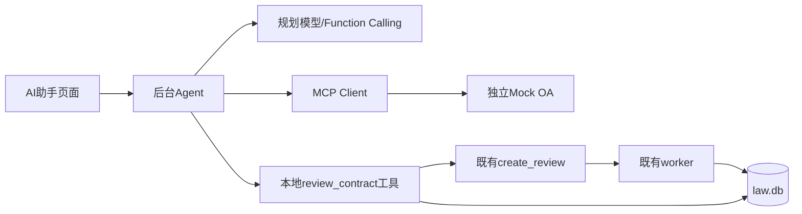

# OA MCP Client 与 Agent 验收记录

本文件记录上一轮固定8步版本的验收，以下历史数字与限制未被改写。当前动态上限和新验收见 [dynamic-rounds-notes.md](dynamic-rounds-notes.md)。

## 架构与边界

OA是独立本地Python 3.13 FastAPI服务，官方mcp==2.3.0提供Streamable HTTP。主系统仍是Python 3.9：app/services/mcp_client.py用现有httpx实现initialize、initialized、tools/list、tools/call，以及JSON/SSE响应解析。原requirements未升级，也未把不兼容的MCP SDK装入主环境。两个环境pip check均通过。

本Client支持所需的工具请求/响应子集，未实现stdio、OAuth、sampling、跨断线事件恢复或2026客户端协议。SDK服务端本身支持新版，已用官方Client额外验证。Client有5秒连接上限、20秒读取/响应上限、2MB响应限制和分页上限，连不上返回明确MCP_CONNECTION_FAILED/MCP_TIMEOUT。SSE按字节流检查大小和时间，不等无限长换行。

发现的三个外部工具：list_contracts、get_contract、write_result。Agent另提供一个本地review_contract工具用于进入现有审查流程，这不是OA的第四个MCP工具。模型只选择工具及参数；合同导入、规则规划、依据校验、落库、合并与报告仍由原有服务及worker执行，没有改工单逻辑。

write_result必须有本run真实完成的审查结果。模型只需传task_id引用，服务端用真实任务的stats、意见和校验后的evidence填充，忽略模型自行拼写的风险结论。不能靠“读过正文”宣称完成审查。立场按用户明确指定或组织匹配决定，模型不能自行猜甲乙方。

## 执行、权限与故障

- POST /agent/run接受request，立即202返回run_id；GET /agent/runs/{id}返回进度、步骤、结果与分项成本。
- admin/reviewer允许，requester固定403，匿名401；reviewer只能读自己Agent run，admin可读全部。
- 每个工具调用（包括失败）算一轮，最多8轮。未知工具、错误参数和工具失败作为tool消息返回模型修正；成本或轮次耗尽时failed并保留partial/summary/details。
- 初次工具发现失败不会调用模型。每次规划调用使用purpose=agent预记并结算llm_logs，SDK重试关闭；原risk-judge严格JSON调用不变。
- 规划token上限50,000（保守输入预检＋真实usage统计），审查token单独计。规划与本run审查的总模型调用上限200；创建子任务时在短事务内给快照分配剩余调用额度，给后续规划留出余量。
- Agent用独立后台线程（最多2个）及/data/agent-runs原子JSON记录，不新增数据库表。HTTP、模型调用和等待worker均在数据库事务外。
- API重启将遗留running run标failed/AGENT_INTERRUPTED，不自动重试或写回。已创建的正常审查任务保留，可继续由worker完成；详情链接仍可核对。Agent初始化失败只影响/agent接口，主审查功能继续服务。

8步并不够完成“列出＋三份逐一获取/审查/写回”（需要10次工具调用）。因此全量三份请求可能返回已完成部分；本轮没有暗中提高8步限制或把多次调用伪装成一轮。单份端到端完整验收通过。

## 真实验收（正式库，无mock、无隔离审查库）

OA本地服务9000，主API/worker使用现有正式Compose数据库data/law.db。仅免费单测使用mock。真实验收前用SQLite backup接口保留/data/before-agent-mcp-20261110.db。

|请求|run_id|步骤|结论|
|---|---|---|---|
|列出 OA 的合同|fc6b67838548419f90c32ee61cc1a077|list_contracts|completed，返回C001/C002/C003|
|审一下 C001|0cda1a297248429e954df485fe4430a4|get_contract → review_contract → write_result|completed，真实审查并写回|

审查关联：

- contract_id：e7505a57abe644d8b146d13de5a02c6b
- task_id：44311428944049b78dbc702d766bef93
- owner=reviewer01，按其组织“示例澄川信息技术有限公司”匹配乙方。
- 10个条款规则＋5个缺失规则，总125项，processed_items=125，progress=1，status=completed。普通审查的既有done_items口径保留；Agent展示processed_items，不伪造工单。
- C001为合同A，结果high=0、medium=2、no_issue=31、not_applicable=92、insufficient/failed/merged均0。不能把0 high解读为完全无风险。
- OA GET /api/contracts/C001的result含相同task_id、统计、意见及依据；不是只在时间线上打印成功。当前OA内存结果保留，重启/重置才会清空。

## 成本（llm_logs新增56条）

|用途|调用|tokens|
|---|---:|---:|
|列合同Agent规划|2|2,035|
|单份审查Agent规划|4|12,499|
|被触发的合同审查|50（45条款＋5缺失）|131,172|
|总计|56|145,706|

规划合计14,534 tokens，每个run均低于50,000；审查单独统计，不混入规划上限。全轮56次低于200。正式库无未知用量、调用错误或额外试跑；完整性检查ok、外键错误0。只读浏览器验证没有新增模型调用。

## 自动化与UI

- 主项目170项完整回归通过（原156项＋新增14项），128.679秒；后续Client/Agent定向14项及RBAC8项复验通过。
- OA独立环境3项测试通过，覆盖REST/MCP、404/413和写回/重置。
- npm run build成功，零新增前端依赖。路由/workspace/agent，侧边栏仅admin/reviewer可见。
- 真实run只读浏览器验收通过：列出3份、三步取/审/写、成本分项、详情链接、刷新恢复、375px、requester菜单/路由/接口403，无浏览器异常。
- 文本以Vue插值展示，不执行合同内容里的HTML。轮询每2秒，终态停止；失败可见，不自动重新发起收费run。

## 实际安装版本与复核文件

OA独立环境：Python3.13，mcp2.3.0、mcp-types2.3.0、FastAPI0.162.2、Uvicorn0.54.0、Pydantic2.14.3、httpx2 2.16.0、sse-starlette3.7.0。主系统Python3.9及原锁定依赖保持不变。

启动说明见mock-oa/README.md；MCP_OA_URL容器内为http://host.docker.internal:9000/mcp，本机原生默认http://localhost:9000/mcp。

证据：work/agent-mcp-acceptance.json、work/agent-cost-audit.json、data/agent-runs/{run_id}.json、work/agent-ui/及各测试日志。
